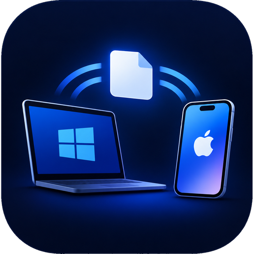

<p align="center">
  
</p>

<h1 align="center">WindowsDrop</h1>

<p align="center">
  iPhone ile Windows bilgisayar arasında <b>fotoğraf ve video aktarımı</b>.<br>
  AirDrop'a benzer, ama iPhone'a uygulama kurmadan çalışır.
</p>

> Sürüm: **1.6.1** · Dil: Python 3 · Platform: Windows 10/11 · Lisans: henüz eklenmedi

---

## İçindekiler

1. [Özellikler](#özellikler)
2. [Nasıl çalışır](#nasıl-çalışır)
3. [Kurulum](#kurulum)
4. [Kullanım](#kullanım)
5. [Masaüstü penceresi, kısayol ve .exe](#masaüstü-penceresi-kısayol-ve-exe)
6. [Ayarlar](#ayarlar)
7. [Güvenlik](#güvenlik)
8. [Dosyalar nereye kaydedilir](#dosyalar-nereye-kaydedilir)
9. [Sorun giderme](#sorun-giderme)
10. [Bilinen sınırlar](#bilinen-sınırlar)
11. [Proje dosyaları](#proje-dosyaları)

---

## Özellikler

| Özellik | Açıklama |
|---|---|
| iPhone → Windows | Fotoğraf ve video seç, ilerleme çubuğuyla gönder. Büyük videolar için boyut sınırı yok. |
| Windows → iPhone | Bilgisayar penceresine dosya sürükle, iPhone'da "Bilgisayardan gelenler" bölümünden aç ya da indir. |
| Önizleme | Gelen fotoğraflar küçük önizleme olarak listelenir. Videolar ▶ işaretiyle gösterilir. |
| Toplu indirme | Gelen fotoğraf ve videoları tek ZIP dosyası olarak indir. |
| Listeyi temizle | Gelen dosya listesini tek tuşla temizle. Dosyalar silinmez, yalnızca listeden gizlenir. |
| Cihaz onayı | Yeni cihaz bağlanınca bilgisayarda 4 haneli kodlu "İzin ver / Reddet" kutusu çıkar. |
| Aktarım özeti | Bitince tarih, saat, adet ve toplam boyut gösterilir. Geçmiş `transfers.csv` dosyasına yazılır. |
| Tekrar uyarısı | Daha önce gönderilen dosyalar fark edilir ve atlanır (istersen yine gönderebilirsin). |
| Çekim tarihi | Dosyanın orijinal çekim tarihi korunur. |
| Disk kontrolü | Yer yetmiyorsa gönderim başlamadan durdurulur. |
| Masaüstü penceresi | Tarayıcı yerine kendi penceresinde açılır. Kapatınca tepsiye iner. |
| Simgeler | Windows kısayolu, `.exe`, tepsi ve iPhone ana ekranında WindowsDrop simgesi. |

---

## Nasıl çalışır

```
 iPhone (Safari)  ──── aynı Wi-Fi ────  Windows bilgisayar
   QR kodu okut                          WindowsDrop küçük bir web sunucusu açar
   sayfa açılır   ───────────────────▶   "Yeni cihaz" onay kutusu
   dosya seç, gönder ────────────────▶   İndirilenler\WindowsDrop
```

Bilgisayarda [Flask](https://flask.palletsprojects.com/) ile küçük bir yerel web sunucusu çalışır (varsayılan port 8080). QR kod, bu sunucunun yerel ağ adresini ve tek seferlik bir anahtarı taşır. iPhone'da hiçbir şey kurulmaz; her şey Safari'de açılan sayfadan yürür.

---

## Kurulum

### Gereksinimler

- Windows 10 veya 11
- [Python 3.9 veya üstü](https://www.python.org/downloads/) (kurarken **"Add Python to PATH"** kutusunu işaretle)
- iPhone ve bilgisayar **aynı Wi-Fi ağında** olmalı

### Adımlar

1. Bu depoyu bir klasöre indir (`Code → Download ZIP`) ve klasöre çıkar.
2. Klasörde terminal aç (adres çubuğuna `cmd` yazıp Enter'a basmak yeterli).
3. Gerekli paketleri kur:

   ```
   pip install -r requirements.txt
   ```

4. Başlat:

   ```
   python windowsdrop.py
   ```

   Uygulama kendi penceresinde açılır. Pencere açılmazsa [Sorun giderme](#sorun-giderme) bölümüne bak.

5. Windows Güvenlik Duvarı ilk çalıştırmada izin sorar. **Yalnızca "Özel ağlar"ı** işaretle, "Genel ağlar"ı işaretleme. İzin vermezsen telefon bağlanamaz.

---

## Kullanım

### iPhone'dan bilgisayara

1. `python windowsdrop.py` ile başlat. Pencerede bir QR kod görünür.
2. iPhone kamerasıyla QR kodu okut, çıkan bağlantıya dokun.
3. iPhone'da 4 haneli bir kod görünür. Bilgisayardaki kutuda aynı kod yazıyorsa **İzin ver**'e bas.
4. iPhone'da **Fotoğraf / Video Seç** ile istediklerini işaretle, **Bilgisayara Gönder**'e bas.
5. Bitince telefonda özet kutusu çıkar. Dosyalar `İndirilenler\WindowsDrop` klasörüne düşer ve bilgisayardaki **Gelen dosyalar** listesinde önizlemeleriyle görünür.

**Tekrar gönderme:** Daha önce aktarılmış dosyalar "Daha önce aktarılmış, atlanacak" diye işaretlenir. Hepsini yeniden göndermek için "Daha önce gönderilenleri de tekrar gönder" kutusunu işaretle.

**HEIC / HEVC:** Safari bazen fotoğrafları JPEG'e çevirerek yükler. Orijinal formatı korumak için seçim ekranında "Seçenekler"den uyumluluk dönüşümünü kapat.

### Bilgisayardan iPhone'a

1. Bilgisayar penceresinde **iPhone'a gönder** alanına dosyaları sürükle ya da **Dosya seç**'e bas.
2. Bağlı iPhone'da sayfanın altında **Bilgisayardan gelenler** bölümü belirir.
3. **Aç** dosyayı Safari'de gösterir; fotoğrafa uzun basıp "Fotoğraflar'a Ekle" diyebilirsin. **İndir** dosyayı Dosyalar uygulamasına indirir.
4. "Tüm bağlantıları kes" düğmesine basınca ya da uygulama kapanınca bu dosyalar silinir.

### Gelen dosyalar listesi

- Fotoğraflar küçük önizleme olarak görünür. Önizlenemeyen biçimlerde (örneğin HEIC) dosya uzantısı yazılır.
- Videolar ▶ işaretiyle gösterilir.
- **Listeyi temizle** düğmesi listeyi boşaltır. Dosyalar silinmez; `İndirilenler\WindowsDrop` klasöründe durmaya devam eder. Temizlemeden sonra yeni gelen dosyalar yine listede görünür.
- **Hepsini indir** düğmesi kayıt klasöründeki fotoğraf ve videoları tek bir ZIP dosyası olarak indirir.

### Bilgisayar penceresindeki düğmeler

- **İzin ver / Reddet:** yeni cihaz onayı
- **Tüm bağlantıları kes:** bütün oturumları kapatır, QR anahtarını yeniler
- **Listeyi temizle:** gelen dosya listesini gizler

### iPhone ana ekran simgesi

1. iPhone'da Safari ile QR kodla açılan sayfayı aç.
2. Paylaş (kare ve ok) simgesine dokun, **Ana Ekrana Ekle**'yi seç, sonra **Ekle**'ye bas.
3. Ana ekranda WindowsDrop simgesi belirir. Ona dokununca uygulama tam ekran, Safari çubukları olmadan açılır.

> Simge bağlantıyı değiştirmez. Kayıtlı adres artık çalışmıyorsa (QR anahtarı süresi dolduysa) bilgisayardaki QR'ı yeniden okut.

---

## Masaüstü penceresi, kısayol ve .exe

### Masaüstü penceresi

Uygulama tarayıcı yerine kendi penceresinde açılır. Pencereyi kapatmak uygulamayı kapatmaz; pencere tepsiye iner. Tepsi simgesine çift tıklayarak ya da **Paneli aç**la pencereyi geri getirebilirsin. Pencere için `pywebview` gerekir (`requirements.txt` ile gelir). Kurulu değilse uygulama tarayıcıda açılır.

### Başlat menüsü kısayolu

```
python windowsdrop.py --install-shortcut
```

Başlat menüsüne WindowsDrop kısayolu ekler. Konsol penceresi açmadan çalışır ve kısayolun simgesi WindowsDrop simgesidir. Kaldırmak için:

```
python windowsdrop.py --remove-shortcut
```

Program zaten çalışıyorsa ikinci kez başlatılmaz, mevcut pencere öne getirilir.

### Tepsi simgesi

Sağ alttaki bildirim alanında WindowsDrop simgesi görünür. Simgeye çift tıklamak ya da sağ tıklayıp **Paneli aç** demek pencereyi öne getirir. **Çıkış** uygulamayı kapatır. `pystray` kurulu değilse uygulama simgesiz çalışmaya devam eder.

### .exe yapmak (isteğe bağlı)

Python kurulu olmayan bir bilgisayarda kullanmak istersen, depodaki `build_exe.bat` dosyasını çift tıkla. `icon.ico`, `icon-512.png` ve `apple-touch-icon.png` aynı klasörde olmalı.

Komut satırından yapmak istersen:

```
pip install pyinstaller
python -m PyInstaller --clean --noconfirm WindowsDrop.spec
```

Çıktı `dist\WindowsDrop.exe` dosyasıdır. Simge ve dosya sürüm bilgisi (Windows özelliklerinde de görünür) uygulamanın güncel sürümünden üretilir. Başlat menüsüne eklemek için `dist\WindowsDrop.exe --install-shortcut`.

> Uygulama içinden güncelleme yoktur. Yeni sürüme geçerken WindowsDrop'u kapatıp yeni `WindowsDrop.exe` dosyasını eskisinin yerine koy. `windowsdrop_config.json` ayarların korunur. PyInstaller ile üretilen dosyaları bazı antivirüs programları yanlışlıkla işaretleyebilir.

---

## Ayarlar

İlk çalıştırmada `windowsdrop_config.json` dosyası, program dosyasının yanında oluşur.

| Alan | Varsayılan | Açıklama |
|---|---|---|
| `port` | `8080` | Sunucunun portu. Başka bir program kullanıyorsa değiştir. |
| `save_dir` | `""` | Boşsa `İndirilenler\WindowsDrop`. Başka klasör için tam yol yaz. |
| `min_free_mb` | `512` | Aktarım sonrası diskte en az bu kadar (MB) boş yer kalmalı. |

---

## Güvenlik

WindowsDrop evdeki kendi ağında kullanım için tasarlandı.

1. **Yalnızca yerel ağ.** İnternet IP'lerinden gelen her istek reddedilir. Bilgisayarın yönetim sayfaları yalnızca bilgisayarın kendisinden açılır.
2. **Kısa ömürlü QR anahtarı.** Anahtar 10 dakikada yenilenir ve bir cihaz onaylanınca da yenilenir.
3. **Cihaz onayı.** Her yeni cihaz için bilgisayarda "İzin ver / Reddet" ve eşleşme kodu. Onay olmadan hiçbir dosya yüklenemez.
4. **Cihaza bağlı oturum.** Oturum yalnızca onaylanan cihazın IP'sinden çalışır ve 2 saat sonra biter.
5. **Dosya türü sınırı.** Telefondan yalnızca foto/video uzantıları kabul edilir; `.exe` gibi dosyalar reddedilir.
6. **Deneme sınırı.** Yanlış anahtar deneyen ya da 3 kez reddedilen IP engellenir.
7. **Otomatik kapanma.** 15 dakika hareketsizlikte uygulama kapanır (devam eden yükleme varsa kapanmaz).
8. **Tarayıcı korumaları.** CSP, `no-store`, Host kontrolü ve yönetim isteklerinde CSRF başlığı kullanılır. Önizleme ve listeleme istekleri de yalnızca bu bilgisayardan kabul edilir.

### Bilinen risk

Bağlantı **şifresiz HTTP**'dir. Evdeki kendi ağında bu risk pratikte küçüktür, ama kafe, otel, ofis gibi ortak Wi-Fi'larda **kullanma**: ağı dinleyen biri anahtarı görebilir. Modeminde "port yönlendirme" açık olmadığından da emin ol.

---

## Dosyalar nereye kaydedilir

| Ne | Nerede |
|---|---|
| Gelen fotoğraf/video | `İndirilenler\WindowsDrop` (`save_dir` ile değişir) |
| Aktarım geçmişi | `C:\Users\<sen>\.windowsdrop\transfers.csv` (Excel'de açılır) |
| Daha önce gönderilenler listesi | `C:\Users\<sen>\.windowsdrop\seen.jsonl` |
| Konsolsuz çalışırken günlük | `C:\Users\<sen>\.windowsdrop\windowsdrop.log` |
| Ayarlar | `windowsdrop_config.json` (program dosyasının yanında) |

Dosya adı çakışırsa üzerine yazılmaz, sonuna `__1`, `__2` eklenir.

**Çekim tarihi:** Fotoğraflarda EXIF'ten, videolarda dosyanın kayıt bilgisinden okunur. Bulunamazsa telefonun bildirdiği tarih kullanılır. Geçersiz ya da gelecekteki tarihler yok sayılır.

---

## Sorun giderme

| Sorun | Çözüm |
|---|---|
| Telefon sayfaya bağlanamıyor | Aynı Wi-Fi'da olduğunuzdan emin ol. Güvenlik duvarında "Özel ağlar" izni ver. Wi-Fi ağın "Genel" olarak işaretliyse Windows'ta "Özel" yap. Bazı modemlerde "AP izolasyonu / istemci yalıtımı" kapalı olmalı. |
| "Anahtar geçersiz veya süresi dolmuş" | Bilgisayardaki QR kodu yeniden okut. Anahtar her 10 dakikada ve her onayda yenilenir. |
| "Port kullanımda" benzeri hata | `windowsdrop_config.json` içinde `port` değerini değiştir (örn. 8090). |
| "Çok fazla deneme yapıldı" | Uygulamayı kapatıp yeniden aç; engel listesi sıfırlanır. |
| Dosyalar atlanıyor | "Daha önce aktarılmış" işaretlidir. "Daha önce gönderilenleri de tekrar gönder" kutusunu işaretle. |
| "Yeterli disk alanı yok" | Yer aç ya da `min_free_mb` değerini düşür. |
| HEIC yerine JPEG geliyor | iPhone seçim ekranında "Seçenekler"den dönüşümü kapat. |
| Pencere açılmıyor, tarayıcıda açılıyor | `pip install -r requirements.txt` ile `pywebview` kurulu mu kontrol et. Windows 10/11'de WebView2 genelde zaten kuruludur. |
| Önizleme görünmüyor | HEIC ve TIFF gibi biçimler tarayıcıda gösterilemez; uzantı yazılı olarak görünür. |
| Yeni sürüme geçme | Uygulamayı kapatıp yeni `WindowsDrop.exe` dosyasını eskisinin yerine koy. |
| Uygulama kendiliğinden kapandı | 15 dakika hareketsizlikte kapanması normaldir; yeniden başlat. |

---

## Bilinen sınırlar

- Yalnızca Windows için yazıldı. Kısayol, tepsi ve çekim tarihi özellikleri Windows'a özgüdür.
- Masaüstü penceresi için WebView2 gerekir. Yoksa uygulama tarayıcıda açılır.
- Tekrar tespiti dosya **adı ve boyutuna** bakar, içeriğe değil.
- iOS bir web sayfasının doğrudan Fotoğraflar'a kaydetmesine izin vermez; Windows → iPhone yönünde dosya önce Safari'den açılıp ya da Dosyalar'a indirilip kaydedilir.
- Bağlantı şifrelenmemiştir (HTTP); yalnızca güvendiğin ağlarda kullan.

---

## Proje dosyaları

| Dosya | Görevi |
|---|---|
| `windowsdrop.py` | Uygulamanın kendisi: sunucu, sayfalar, pencere ve güvenlik. |
| `requirements.txt` | Gerekli Python paketleri: `flask`, `qrcode[pil]`, `pystray`, `pywebview`. |
| `build_exe.bat` | İsteğe bağlı: simgeli `.exe` üretir. |
| `icon.ico` | Windows simgesi (kısayol ve `.exe`). |
| `icon-512.png` | Tepsi ve pencere için büyük simge. |
| `apple-touch-icon.png` | iPhone ana ekran simgesi (180×180). |
| `README.md` | Bu dosya. |

---

